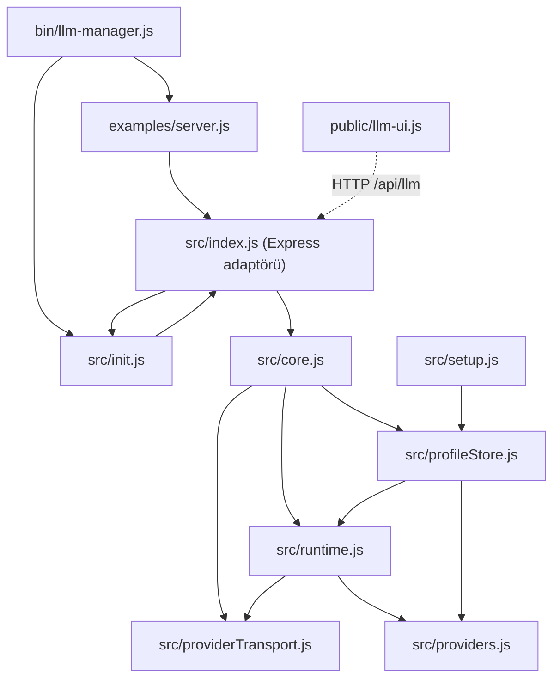
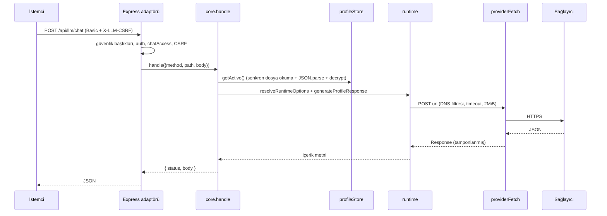
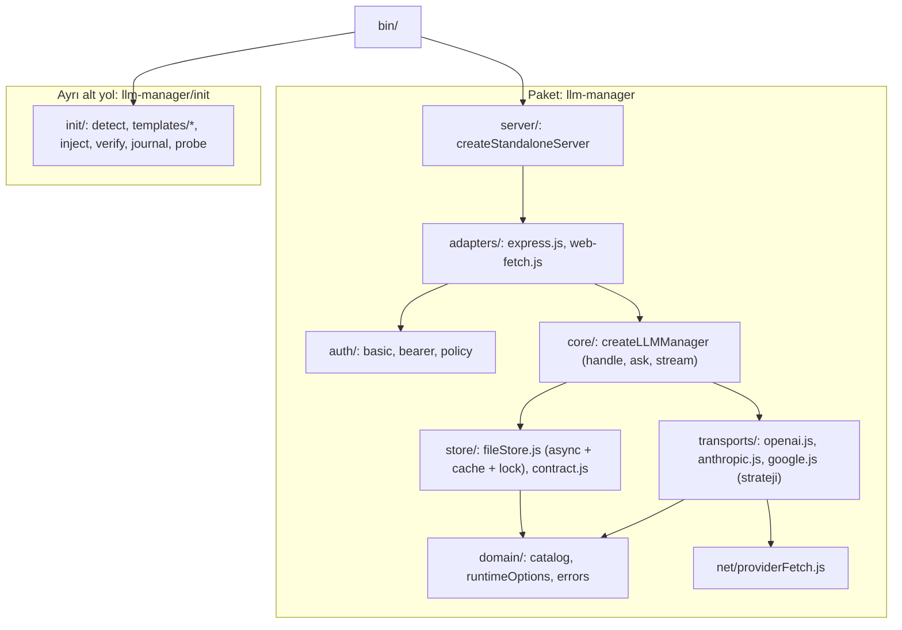

# Yol Haritası 1 — Teknik / Mimari İnceleme ve Geliştirme Planı

> **Hedef kitle:** Bu belgeyi uygulayacak yazılım geliştirici / kod yazan yapay zekâ modeli.
> **İnceleme tarihi:** 2026-10-22 · Sürüm v1.0.0 · commit `2a204c1` · 33/33 test geçiyor.
> **Kardeş belge:** [YOL_HARITASI_2_VAAT_GERCEK_UYUMU.md](YOL_HARITASI_2_VAAT_GERCEK_UYUMU.md). Güvenlik açısından kritik olan **YH2 Faz 0 bu belgeden önce** uygulanmalıdır. Genel sıra için YH2 §5'e bakın.

---

## 0. Uygulama kuralları (her görev için)

YH2 §0'daki kurallar burada da aynen geçerlidir. Kısaca:
- Bir görev bir commit olur; önce test yazılır, ardından `npm test` yeşil olmalıdır.
- CHANGELOG `[Unreleased]` güncellenir. Sırlar asla loglanmaz. Genel API geriye dönük uyumlu kalır.
- Ek kural: **Yeni çalışma zamanı bağımlılığı ekleme.** Gerekiyorsa `optionalDependencies`/`peerDependencies` kullan ve gerekçeyi CHANGELOG'a yaz. Projenin "sıfır host bağımlılığı / basit eklenti" hedefi var.
- Ek kural: Dosya taşırken eski yolu bir sürüm boyunca yeniden dışa aktaran (re-export) bir köprü dosyası bırak.
- **Paket adı (karar onaylandı, 2026-10-23):** `@sirrakadembasti/llm-manager`, hedef sürüm **v2.0.0**. Belgelerde geçen `<PKG>` bu adı ifade eder. CLI komutu `llm-manager` olarak kalır. Ayrıntılar YH2-G07'de.

---

## 1. Mevcut mimari — ne var, nasıl çalışıyor?

### 1.1 Modül haritası

| Modül | Satır | Sorumluluk |
|---|---|---|
| `src/providers.js` | 218 | 20 sağlayıcı + özel sağlayıcı kataloğu, `validateProviderUrl` (HTTPS, yerel/IP engeli) |
| `src/providerTransport.js` | 87 | `providerFetch`: undici Agent + DNS lookup filtresi (SSRF ve DNS rebinding koruması), yönlendirme yasağı, 2 MiB yanıt sınırı |
| `src/credentialValidation.js` | 11 | Xiaomi PAYG / Token Plan anahtar–adres uyumu |
| `src/runtime.js` | 173 | Çalışma seçenekleri doğrulama, sağlayıcı isteği oluşturma (openai/anthropic/google), yanıt ayrıştırma, hata sınıflandırma |
| `src/profileStore.js` | 218 | JSON dosya deposu, AES-256-GCM, atomik yazım (tmp + rename), revizyon (CAS), otomatik anahtar dosyası |
| `src/core.js` | 319 | Framework'ten bağımsız yönlendirici `handle()`, `ask()`, Web `fetch()` adaptörü, test/model listesi/sohbet |
| `src/index.js` | 154 | Express adaptörü `mountLLMManagement`, Basic Auth, chatAccess, CSRF, güvenlik başlıkları |
| `src/setup.js` | 50 | `.env`/anahtar dosyasına şifreleme anahtarı üretme (eski yol) |
| `src/init.js` | 1179 | Kurulum sihirbazı: tip algılama, şablon üretme, kod enjeksiyonu, doğrulama, canlı yoklama, tarayıcı açma |
| `bin/llm-manager.js` | 94 | CLI argüman ayrıştırma; `examples/server.js` dosyasını import ederek sunucu başlatır |
| `public/llm.html`, `llm-ui.js` | ~650 | Bağımsız yönetim arayüzü (vanilla JS, CSP uyumlu) |

### 1.2 Bileşen ilişkileri



> [!WARNING]
> `src/index.js` ↔ `src/init.js` arasında **döngüsel bağımlılık** var (`index` → `init` statik, `init` → `index` dinamik). Ana giriş noktası (`llm-manager`) yalnızca Express eklentisi kullanmak isteyen birine `child_process`, `readline` ve 1179 satırlık sihirbazı da yüklüyor. `profileStore` ↔ `runtime` arasında da kavramsal bir bağ var: depo, çalışma seçeneklerini doğrulamak için runtime'ı import ediyor.

### 1.3 İstek akışı (sohbet)



### 1.4 Güçlü yönler (korunmalı)

- **SSRF savunması doğru katmanda.** DNS çözümü, soket bağlantısının kullandığı lookup ile aynı; bu yüzden DNS rebinding'e karşı dayanıklı. `redirect: 'error'` ve yanıt boyutu sınırı da var.
- **Şifreleme doğru kullanılmış.** AES-256-GCM, 12 baytlık rastgele IV ve 16 baytlık etiket uzunluğu zorunluluğu. Anahtar hiçbir DTO'ya çıkmıyor.
- **İyimser eşzamanlılık (revision/CAS)** ve test sırasında profil değişirse sonucu kaydetmeme.
- **Hata sınıflandırma** üst akış metnini sızdırmıyor ve kullanıcıya eyleme dönük mesajlar veriyor.
- **Çekirdek ile adaptör ayrımı** (`handle()` saf) doğru bir yön; mimari bunun üzerine genişletilmeli.
- **Arayüz XSS'e dayanıklı:** `textContent` kullanılıyor, `innerHTML` yok; CSP `script-src 'self'`.

### 1.5 Mimari zayıflıklar (özet)

| # | Zayıflık | Etki |
|---|---|---|
| Z1 | Katman sınırları bulanık: sihirbaz ana pakete gömülü, CLI sunucusu `examples/` içinde | Gereksiz yük, bakım zorluğu, döngüsel bağımlılık |
| Z2 | Depo senkron; her istekte disk okuma, JSON.parse ve anahtar dosyası okuma | Olay döngüsü bloklanır, async depo desteklenmez |
| Z3 | Hata türü yok; bazı akışlar Türkçe mesaja regex uygulayarak karar veriyor (`core.js:218`, `runtime.js:55,90,93,96`) | Metin değişince mantık bozulur |
| Z4 | Sağlayıcı dönüşümleri tek fonksiyonda if/else | Yeni sağlayıcı ya da yetenek (stream, tools, thinking) eklemek zor |
| Z5 | Kimlik doğrulama yalnız Express adaptöründe | Web adaptörü açık (YH2-G02) |
| Z6 | Gözlemlenebilirlik yok (request-id, log kancası, kullanım/maliyet) | Üretimde sorun ayıklanamaz |
| Z7 | Kötüye kullanım koruması yok (rate limit, brute force, maliyet sınırı) | Kota ve fatura riski |
| Z8 | Tip tanımı yok (`.d.ts`) | TS projelerinde zayıf geliştirici deneyimi |
| Z9 | Testler gerçek framework entegrasyonunu doğrulamıyor; lint ve CI yok | Regresyon riski |
| Z10 | `init.js` 1179 satır, şablonlar string olarak kodun içinde | Okunabilirlik ve test edilebilirlik düşük |

### 1.6 Hedef mimari



Hedef mimarinin ilkeleri:
1. **Bağımlılık yönü tek yönlü:** `adapters → core → (store, transports) → domain`. `domain` hiçbir şey import etmez.
2. **Ana giriş noktası hafif kalır:** `llm-manager` = core + adaptörler; `llm-manager/init` ayrı; Express ve dotenv opsiyonel.
3. **Tüm I/O async**, hatalar tipli (`LLMError` + `code`).
4. **Her sağlayıcı bir strateji nesnesidir:** `{ buildRequest, parseResponse, parseStreamChunk, modelsEndpoint, parseModels, capabilities }`.

> [!NOTE]
> Dosya taşıma işleri büyük bir commit yerine **küçük adımlarla** yapılmalıdır. Her adımda testler yeşil kalmalı ve eski yollar re-export ile korunmalıdır.

---

## 2. Görev kartları

Biçim: **Öncelik** (P0/P1/P2) · **Efor** (S ≤ 2 saat, M ≤ 1 gün, L > 1 gün) · **Bağımlılık**

### FAZ A — Mimari ayrıştırma (temel; diğer fazlar buna dayanır)

---

#### YH1-A1 — Ana girişi hafiflet; init ve Express bağımlılığını ayır
- **P1 · M · Bağımlılık: yok**
- **Dosyalar:** `src/index.js`, `src/init.js`, `package.json`
- **Yapılacaklar:**
  1. `src/index.js` içinden `init.js` import ve re-export'larını kaldır. Geriye uyum için bir sürüm boyunca şu tembel sarmalayıcıları bırak:
     ```js
     /** @deprecated `llm-manager/init` alt yolunu kullanın. */
     export async function runInteractiveInit(...a) { return (await import('./init.js')).runInteractiveInit(...a); }
     ```
     Senkron fonksiyonlar (`detectProjectType` vb.) için sarmalayıcı yazılamaz. Bunları CHANGELOG'da `Deprecated` olarak duyur ve 2.0'da kaldır.
  2. `src/init.js` başındaki `import express from 'express'` satırını kaldır ve `probeAndOpenBrowser` içinde dinamik import yap. Daha iyisi: A2'deki `createStandaloneServer` fonksiyonunu kullan.
  3. `package.json`:
     - `express` → `peerDependencies: { "express": "^4.19.2 || ^5.0.0" }` ve `peerDependenciesMeta: { express: { optional: true } }`. Geliştirme için `devDependencies` içinde tut.
     - `dotenv` yalnız CLI'da kullanılıyor. Node ≥ 20.12'deki `process.loadEnvFile()` ile değiştir ve bağımlılığı kaldır. `setup.js` içindeki `dotenv.parse` yerine basit bir ayrıştırıcı yaz (`KEY=VALUE`, `#` yorum, tırnak soyma) ya da `util.parseEnv` (Node ≥ 21.7) kullan.
  4. `src/core.js` Express import etmemeli; şu an etmiyor, bunu bir testle kilitle: `core.js` import grafiğinde `express` olmamalı.
- **Kabul:** `node -e "import('@sirrakadembasti/llm-manager/core')"` express kurulu değilken çalışır. `src/index.js` içinde `init.js` statik importu yoktur.
- **Test:** express'i geçici olarak `node_modules` dışına alan bir izolasyon testi zor; bunun yerine `src/core.js` ve bağımlılıklarının kaynaklarını tarayıp `from 'express'` geçmediğini doğrula.

---

#### YH1-A2 — Bağımsız sunucuyu `src/server.js` içine taşı
- **P1 · S · Bağımlılık: A1**
- **Dosyalar:** yeni `src/server.js`, `examples/server.js`, `bin/llm-manager.js`, `src/init.js` (`probeAndOpenBrowser`)
- **Yapılacaklar:**
  1. Şu imzayı yaz:
     ```js
     export async function createStandaloneServer({
       host = '127.0.0.1', port = 8010, adminUser = 'admin', adminPassword,
       allowedOrigins = [], dataDir, chatTokens, logger = console
     }) // → { app, server, url, close() }
     ```
     İçeriği bugünkü `examples/server.js` olsun; CORS ara katmanı YH2-G06 kurallarıyla.
  2. `host` `127.0.0.1` ya da `::1` değilse ve parola 12 karakterden kısaysa başlatmayı reddet: "Ağa açık sunucu için en az 12 karakterlik parola gerekir."
  3. Graceful shutdown: SIGINT/SIGTERM geldiğinde `server.close()` çağır; 10 saniye içinde kapanmazsa `process.exit(1)`.
  4. `bin`: `--host`, `--data-dir` ve `--chat-token` bayraklarını ekle; `await import('../examples/server.js')` yerine `createStandaloneServer` kullan.
  5. `examples/server.js` yalnızca bir kullanım örneği olarak kalsın (5–10 satır).
  6. `probeAndOpenBrowser` kendi Express kurulumunu yapmak yerine `createStandaloneServer({ port, dataDir })` kullansın.
- **Kabul:** `package.json#files` içinden `examples` çıkarılsa bile CLI çalışır.

---

#### YH1-A3 — TypeScript tip tanımları
- **P1 · M · Bağımlılık: A1, A4**
- **Dosyalar:** yeni `types/index.d.ts`, `types/core.d.ts`, `types/init.d.ts`, `types/runtime.d.ts`, `types/transport.d.ts`, `package.json`
- **Yapılacaklar:**
  1. Genel tipleri tanımla: `LLMProfilePublic`, `LLMProfileInternal` (apiKey + transport), `LLMMessage { role: 'system'|'user'|'assistant'; content: string }`, `LLMStore` (tüm metotlar `T | Promise<T>`), `LLMManager { handle, ask, fetch, stream?, store }`, `MountOptions`, `ChatResult`, `LLMErrorCode` (string literal union).
  2. `package.json#exports` alanını koşullu yap:
     ```json
     ".": { "types": "./types/index.d.ts", "default": "./src/index.js" }
     ```
     Diğer alt yolları da aynı biçimde düzenle; ayrıca kök `"types"` alanını ekle.
  3. `devDependencies` içine `typescript` ekle. `npm run typecheck` script'i `tsc -p types/tsconfig.json --noEmit` çalıştırsın; küçük bir `types/test.ts` örnek kullanım dosyası derlensin.
- **Kabul:** `types/test.ts` hatasız derlenir ve `npm test` öncesinde `typecheck` çalışır (CI'da).

---

#### YH1-A4 — Tipli hata modeli
- **P1 · M · Bağımlılık: yok**
- **Dosyalar:** yeni `src/errors.js`, `src/runtime.js`, `src/core.js`, `src/profileStore.js`, `src/providerTransport.js`
- **Yapılacaklar:**
  1. Hata sınıfını yaz:
     ```js
     export class LLMError extends Error {
       constructor(code, message, { status, retryable, upstreamStatus, cause } = {}) {
         super(message, { cause }); this.name = 'LLMError';
         Object.assign(this, { code, status, retryable, upstreamStatus });
       }
     }
     export const ErrorCodes = Object.freeze({ RUNTIME_OPTIONS_INVALID: 'RUNTIME_OPTIONS_INVALID', PROFILE_INVALID: 'PROFILE_INVALID', /* ...tüm kodlar */ });
     ```
  2. `normalizeRuntimeOptions` hata fırlatırken `code: 'RUNTIME_OPTIONS_INVALID'` kullansın. `core.js:218` satırındaki regex kontrolünü `error.code === 'RUNTIME_OPTIONS_INVALID'` ile değiştir.
  3. `providerFetch` boyut aşımında `new LLMError('LLM_RESPONSE_TOO_LARGE', ...)`; ağ hatalarında `LLM_NETWORK` (cause korunur); DNS politika ihlalinde `LLM_DNS_BLOCKED` fırlatsın.
  4. `classifyLLMError` önce `error.code` alanına baksın (bilinen kodlar tablosu). Mesaj regex'leri yalnız **yedek** olarak kalsın. Yeni kodlar ekle: `LLM_RESPONSE_TOO_LARGE`, `LLM_DNS_BLOCKED`, `LLM_CONTENT_FILTERED` (Google `finishReason: 'SAFETY'`, OpenAI `content_filter`), `LLM_UPSTREAM_UNAVAILABLE` (5xx, retryable).
  5. Store hataları (`conflictError`, `notFoundError`, doğrulama) `LLMError` kullansın; doğrulama hatalarının kodu `PROFILE_INVALID` olsun.
  6. Kullanıcı tarafından iptal (`options.signal` abort) ile zaman aşımı ayrı kodlarla ayrılsın: `LLM_ABORTED` ve `LLM_TIMEOUT`.
- **Kabul:** Kod tabanında hata türüne karar vermek için Türkçe metin regex'i kalmaz (yalnız `classifyLLMError` yedek yolu hariç).
- **Test:** Her kod için en az bir birim testi.

---

#### YH1-A5 — Sağlayıcı dönüşümlerini strateji desenine böl
- **P2 · M · Bağımlılık: A4**
- **Dosyalar:** yeni `src/transports/openai.js`, `anthropic.js`, `google.js`, `index.js`; `src/runtime.js`, `src/core.js` (`extractModelIds`)
- **Yapılacaklar:**
  1. Her transport şu arayüzü sağlasın:
     ```js
     export default {
       id: 'openai',
       authHeaders(profile) {},
       chatEndpoint(profile) {},       // suffix
       buildBody(profile, messages, opts) {},
       parseResponse(payload) {},      // → { content, finishReason, usage, reasoning? }
       parseStreamEvent(line) {},      // C4 için; şimdilik null
       modelsEndpoint(profile) {},
       parseModels(payload) {},
       normalizeMessages(messages) {}  // sağlayıcı kısıtları
     };
     ```
  2. `buildProviderRequest` ve `generateProfileResponse` dispatch yapsın; davranış **birebir** aynı kalsın (mevcut testler değişmeden geçmeli).
  3. `normalizeMessages` içinde:
     - **Anthropic:** ardışık aynı rolleri `\n\n` ile birleştir. İlk mesaj `assistant` ise başa `{role:'user', content:'.'}` ekleme; bunun yerine `MESSAGES_INVALID` hatası ver.
     - **Google:** ardışık aynı rolleri birleştir.
     - **Perplexity** (openai transport + `profile.provider === 'perplexity'`): rollerin dönüşümlü olması gerekir; ardışık aynı rolleri birleştir.
  4. `usage` alanını normalize et: `{ inputTokens, outputTokens, totalTokens }`. OpenAI `usage.prompt_tokens/completion_tokens`, Anthropic `usage.input_tokens/output_tokens`, Google `usageMetadata.promptTokenCount/candidatesTokenCount`.
- **Kabul:** Mevcut tüm runtime testleri değişmeden geçer. Yeni testler `normalizeMessages` ve `usage` alanlarını kapsar.

---

#### YH1-A6 — `init.js` modülerleştirme
- **P2 · M · Bağımlılık: YH2 Faz 1'deki init görevleri bittikten sonra** (önce davranış düzelsin, sonra yapı).
- **Yapılacaklar:** `src/init/` klasörü oluştur: `detect.js`, `templates/` (her tip için ayrı `.js` modülü; şablonlar fonksiyon döndürür), `inject.js`, `verify.js`, `journal.js`, `probe.js`, `interactive.js`, `index.js` (eski genel API'yi re-export eder). `src/init.js` dosyası `export * from './init/index.js'` olarak kalsın.
- **Kabul:** Hiçbir dosya 300 satırı geçmez ve testler değişmeden geçer.

---

### FAZ B — Depo (store) sağlamlığı

---

#### YH1-B1 — Okuma önbelleği ve anahtar önbelleği
- **P1 · S · Bağımlılık: YH2-G08 (async store)**
- **Dosyalar:** `src/profileStore.js`
- **Sorun:** `read()` her çağrıda `existsSync + readFileSync + JSON.parse` yapıyor. `getKeyBytes()` her `decrypt` çağrısında anahtar dosyasını yeniden okuyor.
- **Yapılacaklar:**
  1. `let cache = { mtimeMs, size, data }` tut. `read()` önce `fs.statSync` yapsın; mtime ve size değişmediyse önbelleği döndürsün. Bir `structuredClone(data)` kopyası dönsün ki çağıranın değişiklikleri önbelleği kirletmesin.
  2. `write()` sonrası önbelleği yeni veriyle güncelle.
  3. Anahtar baytlarını ilk başarılı okumadan sonra kapanış (closure) içinde sakla (`keyBytes ??= parseEncryptionKey(...)`).
  4. Bu adımda depoyu async'e çevirme (YH2-G08 çekirdeği `await` ile uyumlu hale getiriyor). Async `fs.promises` dönüşümü B2 ile birlikte yapılacak.
- **Kabul:** Peş peşe 1000 `getActive()` çağrısında dosya yalnızca bir kez okunur (`fs.readFileSync` sayacı ile test edilir; `mock.method` kullan).

---

#### YH1-B2 — Yazma kilidi, çok süreç güvenliği, Windows rename dayanıklılığı
- **P1 · M · Bağımlılık: B1**
- **Dosyalar:** `src/profileStore.js`, yeni `src/store/fileLock.js`
- **Yapılacaklar:**
  1. **Süreç içi:** mutasyon yapan metotlar (`save`, `remove`, `activate`, `recordTest`) bir promise kuyruğundan geçsin (`let chain = Promise.resolve(); const exclusive = fn => (chain = chain.then(fn, fn));`). Bu adımla metotlar async olur (çekirdek zaten await ediyor).
  2. **Süreçler arası:** `fileLock.js` yaz. `fs.openSync(lockPath, 'wx')` ile kilit al; kilit dosyasına `{pid, at}` yaz. Kilit 10 saniyeden eskiyse ve pid yaşamıyorsa (`process.kill(pid, 0)` hata verirse) kilidi kaldır ve yeniden dene. 50 ms aralıkla en fazla 5 saniye bekle; süre dolarsa `STORE_LOCKED` hatası ver.
  3. Kilit altında oku → değiştir → yaz akışını uygula; kilit alınınca önbelleği geçersiz kıl.
  4. **Windows:** `renameSync` `EPERM`/`EBUSY`/`EACCES` verirse 20, 50, 100, 200 ms bekleyerek en fazla 4 kez yeniden dene.
  5. README'deki "tek yazıcı/süreç içindir" notunu "çok süreçli kullanım dosya kilidiyle desteklenir; ağ dosya sistemlerinde (NFS/SMB) garanti verilmez" olarak güncelle.
- **Kabul:** İki ayrı `child_process.fork` ile eşzamanlı 50'şer `save` yapıldığında 100 profil kaydedilir, kayıp olmaz.

---

#### YH1-B3 — Şema sürümü, bozuk dosya kurtarma, yedek
- **P1 · S · Bağımlılık: B2**
- **Yapılacaklar:**
  1. Dosya biçimini `{ version: 1, activeId, profiles }` yap. `version` alanı yoksa bunu "v0" say ve ilk yazımda `version: 1` ekle. `migrate(data)` fonksiyonunu ileride kullanılacak biçimde yaz.
  2. Bilinmeyen (daha yeni) bir sürümle karşılaşınca `STORE_VERSION_UNSUPPORTED` hatası ver ve dosyanın üzerine **yazma**.
  3. `JSON.parse` hata verirse `STORE_CORRUPT` hatası ver. Mesaj Türkçe olsun ve `.bak` dosyasından nasıl kurtarılacağını anlatsın.
  4. Her başarılı yazımdan önce mevcut dosyayı `llm-profiles.json.bak` olarak kopyala (tek kuşak yedek).
- **Kabul:** Bozuk JSON dosyası 500 yerine anlamlı bir hata kodu döndürür; arayüz bu mesajı gösterir.

---

#### YH1-B4 — Anahtar yönetimini tekilleştir; döndürme, dışa ve içe aktarma
- **P2 · M · Bağımlılık: B2**
- **Dosyalar:** `src/setup.js`, `src/profileStore.js`, `bin/llm-manager.js`
- **Sorun:** İki ayrı anahtar kaynağı var: `setup.js` (geliştirmede `.env` dosyasına yazar) ve depo (`llm-encryption.key`). `.env` yüklenmeden çalıştırılırsa "anahtar yok" hatası oluşuyor.
- **Yapılacaklar:**
  1. Tek gerçek kaynak şu öncelik sırasıyla belirlensin: `encryptionKey` seçeneği > `LLM_CONFIG_ENCRYPTION_KEY` ortam değişkeni > anahtar dosyası (varsayılan). `ensureLLMEncryptionKey` artık `.env` dosyasına **yazmasın**; anahtar dosyasını kullansın. Eski davranış `{ writeEnv: true }` seçeneğiyle korunsun ve `@deprecated` olarak işaretlensin.
  2. CLI alt komutları:
     - `llm-manager key rotate`: yeni anahtar üretir, kilit altında tüm `secret` alanlarını yeniden şifreler, eski anahtarı `llm-encryption.key.old-<tarih>` olarak saklar.
     - `llm-manager export --out yedek.json`: kullanıcının girdiği bir paroladan scrypt ile türetilen anahtarla şifreli taşınabilir yedek üretir.
     - `llm-manager import yedek.json`
  3. README'ye "Anahtar kaybedilirse profiller kurtarılamaz" uyarısını ve yedekleme yönergesini ekle.
- **Kabul:** Döndürme sonrası tüm profiller okunabilir ve eski anahtarla şifre çözme başarısız olur.

---

### FAZ C — Çalışma zamanı ve özellik eksikleri

---

#### YH1-C1 — Mesaj doğrulama ve boyut sınırları
- **P1 · S · Bağımlılık: A4**
- **Dosyalar:** `src/core.js`
- **Yapılacaklar:**
  1. `chatCompletion` içinde şunları uygula:
     - `role ∈ {system,user,assistant}`
     - Mesaj sayısı ≤ `limits.maxMessages` (varsayılan 100)
     - Toplam karakter ≤ `limits.maxChars` (varsayılan 200 000)
     - Tek mesaj ≤ 100 000 karakter
     - En az bir `user` mesajı
     Sınırlar `createLLMManager({ limits })` ile değiştirilebilsin.
  2. `fetch` adaptöründe gövdeyi okumadan önce `Content-Length` > `limits.maxBodyBytes` (varsayılan 256 KB) ise 413 dön. `Content-Length` yoksa akışı sayarak oku ve sınırı aşınca kes.
  3. `request.json()` hatasında sessizce `{}` dönme; `400 BODY_INVALID` dön.
- **Kabul:** `role: 'tool'` → 400 `MESSAGES_INVALID`; 300 KB gövde → 413.

---

#### YH1-C2 — Sohbet çağrılarında maliyet kontrolü (override yetkisi)
- **P1 · S · Bağımlılık: YH2-G01**
- **Sorun:** Admin olmayan bir kullanıcı `/chat` gövdesinde `profileId`, `timeoutMs: 300000` ve `maxOutputTokens: 32768` göndererek maliyeti şişirebilir ve herhangi bir profili kullanabilir.
- **Yapılacaklar:**
  1. `handle({ ..., principal })` parametresi ekle (adaptörler doldurur).
  2. `principal.isAdmin !== true` ise `profileId`, `timeoutMs`, `maxOutputTokens` ve `thinking` alanlarını yok say. `purpose` yalnız `'quick'` ya da `'default'` olabilir.
  3. `ask()` sunucu tarafında güvenilir kod olduğu için admin principal ile çalışır.
  4. `createLLMManager({ chatOverrides: 'admin' | 'all' | 'none' })` seçeneği ekle; varsayılan `'admin'`.
- **Kabul:** Bearer principal ile gönderilen `profileId` yok sayılır ve etkin profil kullanılır.

---

#### YH1-C3 — Rate limit ve brute-force koruması
- **P1 · M · Bağımlılık: A2**
- **Dosyalar:** yeni `src/rateLimit.js`, adaptörler
- **Yapılacaklar:**
  1. Bağımlılıksız, bellek içi token bucket yaz: `createRateLimiter({ capacity, refillPerSec })` → `take(key) => { ok, retryAfterSec }`. Map boyutunu sınırla (en fazla 10 000 anahtar, LRU benzeri temizlik).
  2. Basic Auth hataları: IP başına dakikada 10 deneme; aşılırsa `429` + `Retry-After`. Başarılı girişte sayaç sıfırlanır.
  3. `/chat`: principal (ya da IP) başına varsayılan dakikada 30 istek. `/profiles/:id/test` ve `/models`: dakikada 10.
  4. Seçenek: `rateLimit: false | { chatPerMinute, testPerMinute, authFailuresPerMinute }`. Host kendi sınırlayıcısını kullanıyorsa kapatabilsin.
  5. IP tespiti Express'te `req.ip` ile yapılır (host `trust proxy` ayarından sorumludur, belgele). Web adaptöründe `getClientId(request)` seçeneği eklenir; verilmezse yalnız principal kullanılır.
- **Kabul:** 11. hatalı giriş 429 döner; sohbet sınırı aşılınca 429 + `code: 'RATE_LIMITED'` döner.

---

#### YH1-C4 — Akış (streaming) desteği
- **P2 · L · Bağımlılık: A5**
- **Yapılacaklar:**
  1. Transport'lara `parseStreamEvent` ekle: OpenAI SSE `data: {choices[0].delta.content}` + `[DONE]`; Anthropic `content_block_delta` olayları; Google `:streamGenerateContent?alt=sse`.
  2. `providerFetch` bugün yanıtı tamamen tamponluyor. `stream: true` seçeneği ekle: tamponlama yapmasın, sayaçlı bir `ReadableStream` döndürsün (2 MiB sınırını toplamda değil olay başına ya da 8 MiB toplam olarak uygula).
  3. Çekirdeğe `llm.stream(promptOrMessages, options)` ekle: `AsyncIterable<{ type: 'delta', text } | { type: 'done', usage, finishReason }>` döndürsün.
  4. HTTP: `POST /chat` + `{ stream: true }` → `text/event-stream`. Olay biçimi: `event: delta\ndata: {"text":"..."}\n\n`, sonda `event: done`. Hata `event: error` + sınıflandırılmış gövde ile bildirilsin.
  5. İstemci bağlantıyı kapatınca (`req.on('close')` / `request.signal`) üst akışa giden isteği abort et.
- **Kabul:** Mock SSE sunucusuyla üç transport için delta sırası ve `done` olayı test edilir.

---

#### YH1-C5 — Üretim parametreleri ve kullanım bilgisi
- **P2 · S · Bağımlılık: A5**
- **Yapılacaklar:**
  1. Profil ve çağrı düzeyinde opsiyonel `temperature` (0–2), `topP` (0–1), `stop` (≤ 4 dize) ve `responseFormat: 'text' | 'json'` (OpenAI uyumlu ise `response_format: {type:'json_object'}`, Google'da `responseMimeType`) desteği ekle.
  2. `/chat` yanıtına `usage` ve `finishReason` ekle. `ask(p, { raw: true })` tam sonuç nesnesini döndürsün; varsayılan dönüş string olarak kalsın (geriye uyum).
  3. Arayüz formuna gelişmiş ayarlar bölümü ekle (`<details>`).

---

#### YH1-C6 — Yeniden deneme ve yedek (fallback) profil
- **P2 · M · Bağımlılık: A4**
- **Yapılacaklar:**
  1. `retry: { attempts: 2, baseMs: 500, maxMs: 4000 }` seçeneği ekle. Yalnız `retryable === true` olan kodlarda yeniden dene (429, 5xx, ağ). `Retry-After` başlığını oku; değer `maxMs`'ten büyükse yeniden deneme. Jitter kullan.
  2. Zaman aşımı bütçesi toplamdır; yeniden denemeler profilin `timeoutMs` süresini aşamaz.
  3. Profile `fallbackProfileIds: string[]` alanı ekle (arayüzde çoklu seçim). Etkin profil retryable bir hatayla düşerse sıradaki profil denensin. Yanıtta `profileId` gerçekten kullanılan profil olsun ve `fallbackUsed: true` alanı eklensin.
- **Kabul:** Mock 503, 503, 200 dizisinde istek başarılı olur. 401'de yeniden deneme yapılmaz.

---

#### YH1-C7 — Düşünme (reasoning) ayarını genelleştir
- **P2 · M · Bağımlılık: A5**
- **Yapılacaklar:** Katalogda sağlayıcı/model başına `capabilities.thinking` tanımla ve `thinking` değerini şöyle eşle:
  - OpenAI o-serisi / gpt-5: `reasoning_effort` (`disabled` → `low`/`minimal`, `enabled` → `medium`)
  - Anthropic: `thinking: { type: 'enabled', budget_tokens }` (`budget_tokens < max_tokens` olmalı)
  - Gemini 2.5+: `generationConfig.thinkingConfig.thinkingBudget` (`disabled` → 0, desteklenen modellerde)
  - Qwen: `enable_thinking`
  - MiMo: mevcut davranış
  Arayüzde düşünme alanı yalnız MiMo için değil, yeteneği olan tüm sağlayıcılar için görünsün.
- **Kabul:** Her eşleme için `buildProviderRequest` gövde testi.

---

#### YH1-C8 — Kurumsal proxy desteği
- **P2 · S**
- **Yapılacaklar:** `proxyUrl` seçeneği (ya da `LLM_HTTPS_PROXY`) verildiğinde undici `ProxyAgent` kullan. Proxy kullanıldığında DNS çözümü proxy'de yapıldığı için yerel SSRF filtresi devre dışı kalır. Bu durumda hedef ana bilgisayar adını katalogdaki **bilinen sağlayıcı alan adları** listesine (ve kullanıcı izin listesine) karşı doğrula. README'ye bu ödünleşimi yaz.

---

#### YH1-C9 — Yerel / LAN model sunucuları (Ollama, LM Studio, vLLM)
- **P2 · S**
- **Yapılacaklar:** `allowedPrivateHosts: ['192.168.1.20:11434', 'ollama.lan']` seçeneği ekle. Yalnız bu açık listedeki ana bilgisayarlar için HTTP ve özel IP'ye izin ver; diğerleri için mevcut kurallar geçerli kalsın. Kataloğa `ollama` girdisi ekle (`http://localhost:11434/v1`, `allowLocalHttp` gerektirir) ve arayüzde bilgi notu göster.

---

#### YH1-C10 — Model kataloğunu veri dosyasına taşı ve güncel tut
- **P2 · S**
- **Yapılacaklar:**
  1. `PROVIDERS` dizisini `src/catalog/providers.json` dosyasına taşı (`catalogVersion`, `updatedAt` alanlarıyla). `providers.js` bu dosyayı okuyup dondursun (`Object.freeze` derin). `GET /catalog` yanıtına `updatedAt` ekle; arayüz bunu göstersin.
  2. Model listelerini 2026-10 itibarıyla güncelle. **Güncel model kimliklerini sağlayıcıların resmi belgelerinden doğrula; uydurma.** Doğrulayamadığın girdiyi listeden çıkar. Liste boş kalsa da olur; "Modelleri getir" mevcut.
  3. `scripts/check-catalog.js` yaz (CI'da opsiyonel, elle çalıştırılır): her sağlayıcının `models` uç noktası ve verilen bir anahtar ile katalogdaki modellerin hâlâ var olup olmadığını raporlasın.
  4. "Modelleri getir" işlemi kaydedilmemiş form için de çalışsın: `POST /models/preview` + `{ provider, baseURL, apiKey? }`. Düzenlenen profilde `apiKey` yoksa kayıtlı anahtar kullanılsın; anahtar yanıtta asla dönmesin. Yalnız admin erişebilsin ve rate limit uygulansın.

---

### FAZ D — Gözlemlenebilirlik ve işletim

---

#### YH1-D1 — Request ID ve log kancası
- **P1 · S**
- **Yapılacaklar:**
  1. Adaptörler her istek için `x-request-id` üretsin (`crypto.randomUUID()`; gelen başlık `^[A-Za-z0-9._-]{8,64}$` desenine uyuyorsa onu kullan). Yanıt başlığına ve hata gövdesine `requestId` olarak eklesin. Arayüz bunu zaten okuyor (`llm-ui.js:30`); şu an hiç üretilmediği için bu kod ölü durumda.
  2. `logger` seçeneği ekle (`{ debug, info, warn, error }`; varsayılan sessiz no-op; CLI'da `console`). Olaylar: `chat.completed {requestId, profileId, provider, model, durationMs, usage, code}`, `profile.saved`, `auth.failed {ip}`.
  3. `redact()` yardımcısı yaz. `apiKey`, `authorization`, `secret`, `password` anahtarlarını derinlemesine maskelesin. Tüm log çağrıları bu fonksiyondan geçsin ve bunu doğrulayan bir test olsun (log çıktısında test anahtarı geçmemeli).
  4. İstem ve yanıt **içeriği** varsayılan olarak loglanmaz (`logContent: false`).

---

#### YH1-D2 — Sağlık uç noktası
- **P2 · S**
- `GET {apiPath}/health` → `{ ok: true, version, hasActiveProfile }`. Kimlik doğrulama gerektirmez ama sır ve profil adı **içermez**. `health: false` seçeneğiyle kapatılabilir.

---

#### YH1-D3 — Docker ve dağıtım
- **P2 · S · Bağımlılık: A2**
- `Dockerfile` (node:22-alpine, root olmayan kullanıcı, `VOLUME /data`, `--host 0.0.0.0`, `HEALTHCHECK` → `/api/llm/health`) ve `.dockerignore` ekle. `docs/DEPLOY.md` (YH2-G19) ile bağlantı kur.

---

#### YH1-D4 — Kullanım kaydı ve basit istatistik
- **P2 · M · Bağımlılık: D1, C5**
- `data/usage-YYYY-MM.jsonl` dosyasına (opsiyonel, `usageLog: true`) istek başına `{at, profileId, model, durationMs, inputTokens, outputTokens, code}` ekle (append). İçerik kaydedilmez. `GET /usage?month=` ile admin için özet sun; arayüzde profil kartında "Bu ay: N istek, X token" göster.

---

### FAZ E — Yönetim arayüzü

---

#### YH1-E1 — Deneme sohbeti paneli
- **P2 · S · Bağımlılık: C1**
- Arayüze "Deneme sohbeti" kartı ekle: profil seçimi (varsayılan etkin profil), system ve user alanları, gönder düğmesi, yanıt kutusu (`textContent`), süre ve usage bilgisi. C4 tamamlandıysa akışlı gösterim yapılsın.

#### YH1-E2 — Çoklu dil (tr/en)
- **P2 · M**
- `public/i18n/tr.json` ve `en.json` sözlüklerini oluştur. `mountLLMManagement({ locale: 'tr' | 'en' })` seçeneğiyle `data-locale` belirlensin. Tüm arayüz metinleri `t('key')` üzerinden gelsin. Sunucu hata mesajları için de `messages` sözlüğü hazırla (kodlar sabit kalır). README'nin İngilizce sürümünü `README.en.md` olarak ekle (projenin "her GitHub reposu" hedefi uluslararası kullanıcıyı da kapsar).

#### YH1-E3 — Küçük arayüz iyileştirmeleri
- **P2 · S**
- `homeUrl` seçeneği (`data-home-url`; bugün arayüz okuyor ama sunucu hiç ayarlamıyor).
- Profil çoğaltma.
- Silme işleminde "Geri al" süresi yerine onay modalı.
- Form alanlarına `aria-describedby` hata bağları.
- Katalog tarihi gösterimi (C10).

---

### FAZ F — Test, kalite ve dağıtım altyapısı

---

#### YH1-F1 — Lint, biçimlendirme ve CI
- **P1 · S**
- `devDependencies` içine `eslint` (flat config, `eslint:recommended` + `no-unused-vars` + `no-floating-promises` yerine `require-await`) ve `prettier` ekle. `npm run lint` ve `npm run format:check` script'lerini tanımla.
- `.github/workflows/ci.yml`: işletim sistemi matrisi `ubuntu-latest, windows-latest, macos-latest` × Node `20.x, 22.x, 24.x` (engines düşürülürse; bkz. F4). Adımlar: `npm ci` → `lint` → `typecheck` → `test`.
- `.editorconfig` ekle ve satır sonlarını tutarlı hale getir (dosyalarda CRLF/LF karışık; `.gitattributes` içinde `* text=auto eol=lf`).

#### YH1-F2 — Gerçek entegrasyon testleri
- **P1 · M**
- `tests/integration/` klasörü: geçici dizinde **gerçek** host uygulamaları oluşturan, `node_modules/<PKG>` için junction kuran ve süreci başlatıp HTTP ile doğrulayan testler:
  - Express 4 ESM, Express 4 CJS, Express 5 ESM (express@5 `devDependencies` içinde alias: `"express5": "npm:express@^5"`).
  - `llm.fetch` için minimal `Bun`/`Deno` gerektirmeyen Node `http` + `Request` köprüsü.
- `tests/e2e/` (opsiyonel, CI'da haftalık ve elle): `create-next-app`, `nuxi init`, `sv create` ile iskelet oluştur → `init -y` → `npm run build` başarılı olmalı. Bu test YH2-G09/G18 düzeltmelerini kanıtlar.
- Mock sağlayıcı sunucusu: `tests/helpers/mockProvider.js` (OpenAI, Anthropic ve Google uyumlu; SSE dahil). `allowLocalHttp: true` ile kullanılır.

#### YH1-F3 — Kapsam ölçümü
- **P2 · S**
- `npm run test:coverage` → `node --test --experimental-test-coverage --test-coverage-lines=80 --test-coverage-branches=70`. Çekirdek (`core`, `runtime`, `profileStore`, `providerTransport`, `auth`) için hedef %85.

#### YH1-F4 — Paket metaverisi ve uyumluluk
- **P2 · S**
- `engines.node`: `>=22.23.2` çok dar. `AbortSignal.any` (20.3+), `process.loadEnvFile` (20.12+) ve `require(esm)` (22.12+, yalnız CJS şablonu için gerekir) ihtiyaçlarını değerlendir. Öneri: `>=20.12` ve CJS şablonunu 22.12 altında dinamik importa düşen yedek yolla üret; **ya da** `>=22.12` tut. Kararı CHANGELOG'a yaz.
- `package.json` alanlarını ekle: `keywords`, `author`, `funding` (opsiyonel), `sideEffects: false` (core için), `publishConfig: { access: 'public' }` (scoped ad, YH2-G07).
- `npm pack --dry-run` çıktısında `tests/`, `data/`, `.env` olmadığını doğrulayan bir CI adımı ekle.

#### YH1-F5 — Güvenlik süreç dosyaları
- **P2 · S**
- `SECURITY.md` (açık bildirme yolu), `CONTRIBUTING.md` (kurallar: test, changelog, commit biçimi) ve `docs/THREAT_MODEL.md` (varlıklar: API anahtarı, admin parolası, istem içeriği; tehditler: SSRF, CSRF, kimlik bilgisi sızıntısı, maliyet kötüye kullanımı, tedarik zinciri; mevcut ve planlanan önlemler).
- `npm audit --omit=dev` CI adımı ekle.

---

## 3. Öncelik özet tablosu

| Faz | Görev | Öncelik | Efor |
|---|---|---|---|
| A | A1 Ana giriş hafifletme | P1 | M |
| A | A2 `src/server.js` | P1 | S |
| A | A3 Tip tanımları | P1 | M |
| A | A4 Tipli hatalar | P1 | M |
| A | A5 Transport stratejisi | P2 | M |
| A | A6 init modülerleştirme | P2 | M |
| B | B1 Önbellek | P1 | S |
| B | B2 Kilit + Windows rename | P1 | M |
| B | B3 Şema sürümü + yedek | P1 | S |
| B | B4 Anahtar döndürme/yedek | P2 | M |
| C | C1 Mesaj doğrulama/limit | P1 | S |
| C | C2 Override yetkisi | P1 | S |
| C | C3 Rate limit | P1 | M |
| C | C4 Streaming | P2 | L |
| C | C5 Parametreler + usage | P2 | S |
| C | C6 Retry + fallback | P2 | M |
| C | C7 Thinking genelleştirme | P2 | M |
| C | C8 Proxy | P2 | S |
| C | C9 LAN modelleri | P2 | S |
| C | C10 Katalog verisi | P2 | S |
| D | D1 Request ID + log | P1 | S |
| D | D2 Health | P2 | S |
| D | D3 Docker | P2 | S |
| D | D4 Kullanım kaydı | P2 | M |
| E | E1 Deneme sohbeti | P2 | S |
| E | E2 i18n | P2 | M |
| E | E3 Küçük UI | P2 | S |
| F | F1 Lint + CI | P1 | S |
| F | F2 Entegrasyon testleri | P1 | M |
| F | F3 Kapsam | P2 | S |
| F | F4 Paket metaverisi | P2 | S |
| F | F5 Güvenlik dosyaları | P2 | S |

**Önerilen sıra:** (YH2 Faz 0) → F1 → A1 → A2 → A4 → (YH2 Faz 1) → B1 → B2 → B3 → C1 → C2 → C3 → D1 → F2 → A3 → A5 → C5 → C6 → C4 → kalan P2 görevler.

> [!TIP]
> F1 (lint + CI) en başa alındı. Sonraki tüm değişikliklerin üç işletim sisteminde otomatik doğrulanması, düşük seviyeli bir modelin yapacağı regresyonları erken yakalar.

## 4. "Bitti" tanımı (Definition of Done) — her görev için

- [ ] Kabul kriterlerinin tamamı sağlandı ve her biri için bir test var.
- [ ] `npm test` (ve varsa `lint`, `typecheck`) yerelde yeşil.
- [ ] Genel API değiştiyse README ve tipler güncellendi.
- [ ] CHANGELOG `[Unreleased]` güncellendi.
- [ ] Sır sızıntısı kontrolü: yeni log, yanıt ve şablonlarda anahtar ya da parola yok.
- [ ] `GEMINI.md` "Durum" bölümüne tek satırlık not düşüldü.
